# Laporan Praktikum 5

Nama          : Jumari  
NIM           : 312510077  
Kelas         : I252A  
Program Studi : Teknik Informatika  
Mata Kuliah   : Pemrograman Web  

## Langkah-Langkah Praktikum

Buka vsc lalu buat file index dan script terlebih dahulu di folder Lab5Web

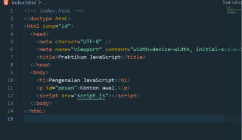

### 1. Menampilkan Hasil

Terjadinya perubahan saat menambahkan script javascript pada paragraf dari konten
awal menjadi hello world.

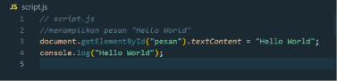

Menampilkan tulisan dalam bentuk head satu dan paragraf

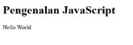

### 2. Alert dan Prompt

Memasukkan nama, menekan cancel, dan membiarkan input kosong. Menggunakan
syntax if untuk mengeksekusi suatu kondisi.

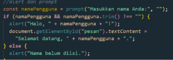

Memasukkan nama sesuai kebutuhan

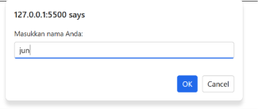

Website akan menampilkan Halo berdasarkan nama yang kita input

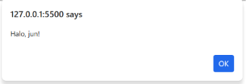

Pada bagian body akan berubah menjadi Selamat datang ditambah nama yang kita input

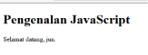

### 3. Function dan Operasi Aritmatika

Menerima dua bilangan, lalu menampilkan hasil penjumlahan, pengurangan, perkalian,
pembagian, dan sisa bagi.

Melakukan aritmatika berdasarkan angka 9 dan 10

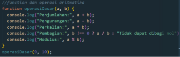

Pada menu inspect element, lalu memilih console. akan muncul hasil yang telah dibuat

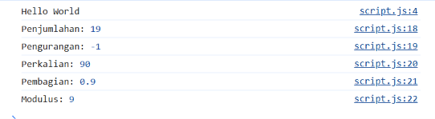

### 4. Seleksi Kondisi if else

Meminta nilai melalui prompt. Nilai minimal 60 dinyatakan lulus.

Jika nilai kurang dari 60, hasilnya tidak lulus

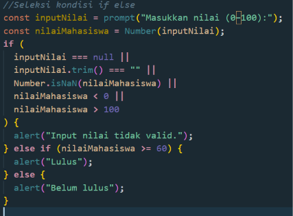

Menampilkan pemilihan angka dari 0 sampai 100

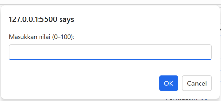

Jika memasukkan angka kurang dari 60

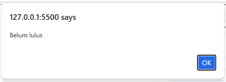

Jika memasukkan angka lebih dari 60

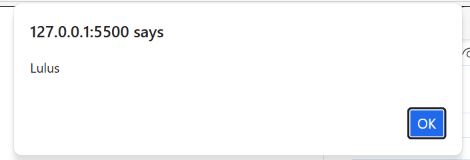

### 5. Seleksi Kondisi Switch

digunakan untuk menjalankan blok kode berbeda berdasarkan kecocokan nilai dari
suatu ekspresi

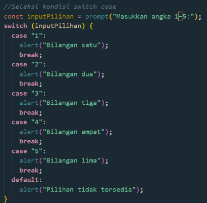

Hasil, kita dapat memilih angka berapapun

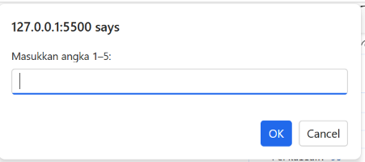

Bila memilih angka dari 1-5

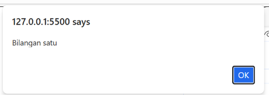

Bila memilih angka diluar 1-5

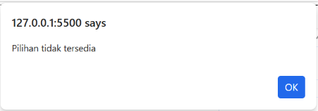

### 6. Form Bilangan Genap dan Ganjil

Pertama kita perlu menyiapkan wadah input dibagian body dan script

Bagian Body

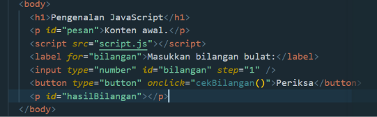

Bagian script, bilangan yang kita input akan menampilkan textContent sesuai kondisi

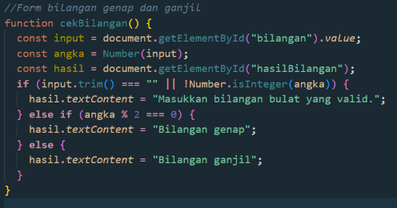

Hasilnya : akan menghasilkan jenis bilangan sesuai yang kita mau

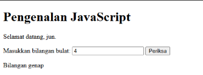

### 7. Mengubah Warna Halaman

Mengubah warna latar halaman. Menggunakan satu function dengan parameter agar
kode tidak berulang.

Pada bagian body

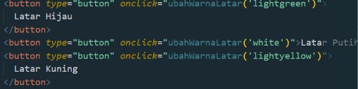

Pada bagian script

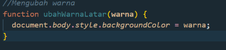

Hasilnya kuning, putih, dan hijau

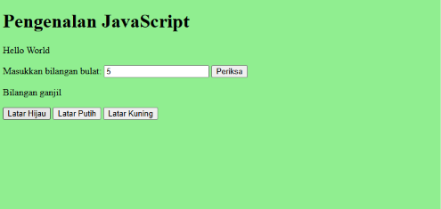

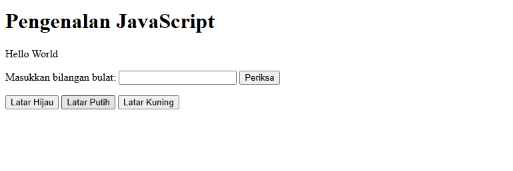

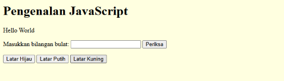

### 8. DOM dan Checkbox Menu Makanan

Menggunakan checkbox. Total harga berubah otomatis ketika pilihan dicentang atau
dilepas. Perlu mendefinisikan di body dan script

Bagian body

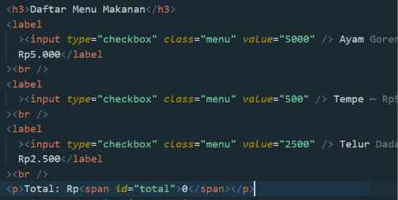

Bagian script

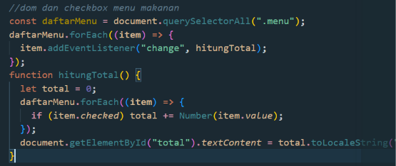

Hasilnya dapat menjumlahkan checkbox sesuai value yang dinyatakan oleh script

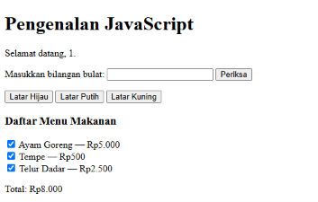

# Pertanyaan dan Tugas

## 1. Perbedaan console.log(), alert(), prompt(), dan textContent/innerHTML

- **console.log():** Mencetak pesan atau data ke Console pada Developer Tools
  browser. Ini murni digunakan oleh programmer untuk debugging atau melacak
  alur kode, dan tidak terlihat langsung oleh pengguna web.
- **alert():** Menampilkan kotak peringatan (pop-up) sederhana di layar yang
  menghentikan aktivitas browser sampai pengguna menekan "OK".
- **prompt():** Menampilkan kotak dialog yang berisi kolom input teks, meminta
  pengguna untuk mengetikkan sesuatu, dan mengembalikan teks tersebut ke
  dalam kode JavaScript.
- **textContent / innerHTML:** Properti untuk membaca atau mengubah isi
  elemen di dalam halaman HTML (DOM). textContent hanya merender teks
  mentah, sementara innerHTML akan menerjemahkan string yang mengandung
  tag HTML menjadi elemen HTML nyata (misalnya, membuat teks tebal dengan
  <b>).

## 2. Perbedaan let dan const

- **let:** Digunakan untuk mendeklarasikan variabel yang nilainya mungkin akan
  diubah atau diperbarui di baris kode selanjutnya.
- **const:** Digunakan untuk variabel konstan yang nilainya tetap. Sekali nilai
  diberikan, kode akan menghasilkan error jika Anda mencoba mengubah
  nilainya.
- **Contoh :**

```javascript
let skor = 10;
skor = 15;
```

nilai skor akan berubah menjadi = 15.

```javascript
cons batasMaksimal = 100;
batasMaksimal = 120
```

akan terjadi error berbunyi = Error: Assignment to constant variable.

## 3. Perbedaan == dan ===

- **== (Loose Equality):** Membandingkan dua nilai, tetapi mengabaikan tipe
  datanya. JavaScript akan mengubah salah satu tipe data secara paksa (type
  coercion) agar bisa dibandingkan. Contoh: 5 == "5" menghasilkan true.
- **=== (Strict Equality):** Membandingkan dua nilai beserta tipe datanya.
  Keduanya harus benar-benar identik. Contoh: 5 === "5" menghasilkan false.
  Sangat direkomendasikan untuk selalu menggunakan === demi menghindari
  bug.

## 4. Fungsi if-else dan switch

- **if-else:** Membuat percabangan logika berdasarkan kondisi yang bernilai true
  atau false.
  - **Kapan digunakan:** Paling baik untuk kondisi yang rumit, rentang nilai
    matematika (seperti harga > 50000), atau memadukan banyak kondisi
    logika (&&, ||).
- **switch:** Mengevaluasi satu variabel dan membandingkannya dengan kumpulan
  nilai spesifik (case).
  - **Kapan digunakan:** Lebih efisien dan rapi saat Anda perlu
    membandingkan satu variabel dengan banyak nilai pasti, seperti
    memilih menu dropdown, mengecek nama bulan, atau memproses
    status pengiriman ("pending", "dikirim", "selesai").

## 5. Fungsi parameter dan return dalam function

- **Parameter:** Pintu masuk data. Parameter adalah variabel sementara yang
  diletakkan di dalam kurung fungsi untuk menerima data (argumen) dari luar
  agar bisa diolah di dalam fungsi tersebut.
- **Return:** Pintu keluar data. Perintah ini menghentikan eksekusi fungsi dan
  melemparkan nilai hasil akhir kembali ke tempat fungsi tersebut dipanggil,
  sehingga nilainya bisa disimpan dalam variabel atau diproses lebih lanjut.

## 6. Cara document.getElementById() memilih elemen HTML

Ketika kode document.getElementById('judul-utama') dijalankan, JavaScript mencari
ke seluruh kerangka dokumen HTML (DOM) untuk menemukan satu-satunya elemen
HTML yang memiliki atribut id="judul-utama". Karena spesifikasi HTML mewajibkan
atribut id harus unik (tidak boleh ada yang kembar di satu halaman), metode ini sangat
cepat, langsung, dan secara eksklusif hanya memilih satu elemen tunggal untuk
dimanipulasi.

## 7. Buat script untuk memvalidasi form agar nama tidak kosong dan nilai berada pada
rentang 0–100.

- Buat formulir dibagian body pada index terlebih dahulu

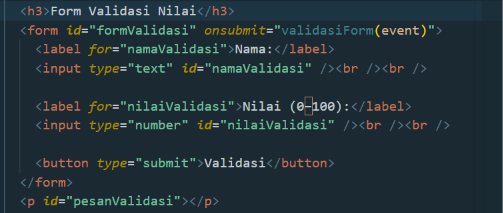

- Buat juga pada bagian script

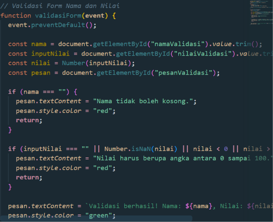

- Hasilnya, tercipta warna merah dan hijau

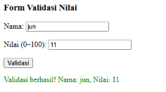

  - warna hijau, bila mengirim nilai direntang 0 sampai 100


  warna merah, bila tidak mengirim angka tidak sesuai ketetapan
